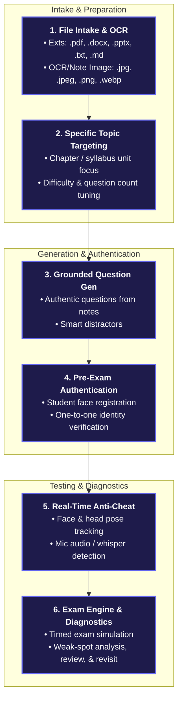

# Soma: Concept & Feature Breakdown

Hey team, here is a clean, top-down breakdown of the vision for **Soma** and what the app looks like when fully built out.

---

### What is Soma?
> **Soma is an AI-powered study partner that transforms raw course materials into realistic practice exams, pairing syllabus-targeted questions with automated proctoring[Monitoring] so students can test their readiness under real exam pressure.**

---

### The 6 Core Features (Full Buildout)



```
┌──────────────────────────────────────┐    ┌──────────────────────────────────────┐
│  1. FILE INTAKE & OCR                │   │  2. SPECIFIC TOPIC TARGETING         │
│  • Direct text: .pdf, .docx, .pptx,  │   │  • Focus on exact chapters/concepts  │
│    .txt, .md                         │   │  • Filter out irrelevant background  │
│  • OCR extract: .jpg, .jpeg, .png,   │   │  • Set difficulty (Recall to Eval)   │
│    .webp for scanned slides & notes  │   │  • Custom question counts & timing   │
└──────────────────────────────────────┘   └──────────────────────────────────────┘
                   │                                          │
                   ▼                                          ▼
┌──────────────────────────────────────┐   ┌──────────────────────────────────────┐
│  3. GROUNDED AI QUESTION GENERATION  │   │  4. PRE-EXAM IDENTITY AUTHENTICATION │
│  • Questions built from your sources │   │  • Fast student face enrollment      │
│  • Real distractors & model answers  │   │  • One-to-one face verification check│
│  • Prompt-injection security shields │   │  • Blocks proxy test takers upfront  │
└──────────────────────────────────────┘   └──────────────────────────────────────┘
                   │                                          │
                   ▼                                          ▼
┌──────────────────────────────────────┐   ┌──────────────────────────────────────┐
│  5. REAL-TIME ANTI-CHEAT PROCTORING  │   │  6. EXAM ENGINE & DIAGNOSTICS        │
│  • Head pose & face movement tracker │   │  • Clean, distraction-free test mode │
│  • Mic audio & whisper monitoring    │   │  • Instant scoring with rationales   │
│  • Tab & multi-person anomaly flags  │   │  • Topic-by-topic mastery breakdown  │
└──────────────────────────────────────┘   └──────────────────────────────────────┘
```

---
[[soma core.png]]
---
### How Each Piece Works

#### 1. Universal File Intake & OCR
Students don't study in one format. They have textbooks, lecture slides, and phone photos of whiteboard notes.
- **Direct documents:** Native parsing for `.pdf`, `.docx`, `.pptx`, `.txt`, and `.md`.
- **Image OCR:** Multimodal vision extraction for `.jpg`, `.jpeg`, `.png`, and `.webp` to pull text from messy slides, handouts, and handwritten summaries.
- Validates file magic bytes and strips garbage before handing clean text to the pipeline.

#### 2. Specific Topic & Syllabus Targeting
Rather than tossing a whole textbook into a blender, the student picks exactly what they need to master:
- Pinpoint a single topic, chapter, or sub-concept (e.g. *"Photosynthesis Light Reactions"* rather than all of Biology).
- Select question formats (Multiple Choice, Short Answer, True/False, Essay).
- Dial in the cognitive difficulty: Recall (Easy), Application (Medium), or Analysis (Hard).

#### 3. Grounded AI Question Generation
The AI acts strictly as an examiner, not a creative writer.
- Generates questions grounded exclusively in the uploaded material—no hallucinations or unstudied tangents.
- Multiple-choice questions use plausible misconceptions as distractors, while written answers include comprehensive scoring rubrics.
- Strict prompt delimiters (`<study_material>`) prevent injected text from tampering with the test structure.

#### 4. Pre-Exam Identity Authentication
Before questions unlock, the system validates who is sitting at the screen.
- The student registers a reference biometric capture during account setup.
- When an exam launches, a camera snapshot verifies the student's face matches the registered profile.
- Prevents impersonation or unauthorized proxy takers before the timer starts.

#### 5. Real-Time Anti-Cheat Proctoring
Once the clock starts, the platform actively ensures genuine testing discipline:
- **Face & Movement Tracking:** MediaPipe face mesh monitors gaze, yaw, pitch, and roll to detect when someone is repeatedly looking away from the screen, leaving their desk, or if a second person enters the frame.
- **Microphone Audio Tracking:** Listens for background whispers, voices, or suspicious sound patterns during the test.
- **Environment Integrity:** Detects lost window focus or attempts to switch tabs to lookup answers.

#### 6. Live Exam Engine & Diagnostic Review
Taking the test feels like a proper exam hall, followed by an immediate learning feedback loop:
- Distraction-free, responsive UI with countdown timer and navigation bar.
- Instant post-test evaluation with correct answers and explanations for every missed item.
- Topic breakdown showing exactly which concepts need further review before exam day.
